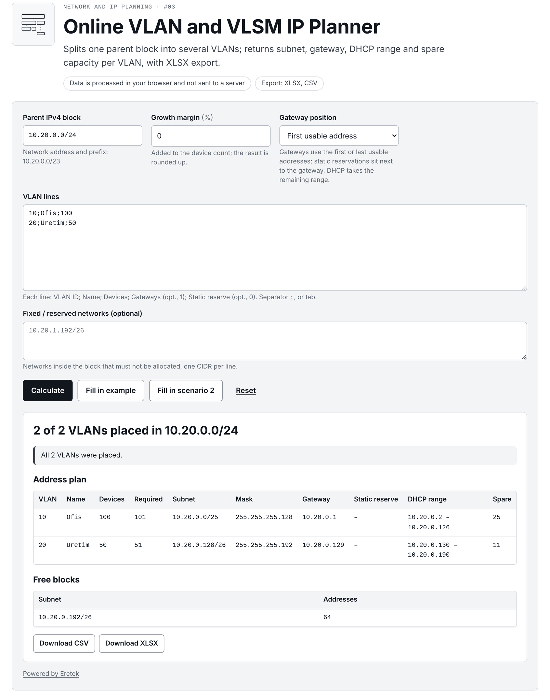

# VLAN and VLSM IP Planner

Split a parent IPv4 block into VLANs with VLSM: subnet, mask, gateway, DHCP range and spare capacity from device counts and growth. Download as XLSX.

## Try it live

- [Türkçe](https://network.eretek.com/araclar/vlan-ip-planlayici)
- [English](https://network.eretek.com/en/tools/vlan-ip-planner)
- [Deutsch](https://network.eretek.com/de/werkzeuge/vlan-ip-planer)



## What it does

Splits one parent block into several VLANs; returns subnet, gateway, DHCP range and spare capacity per VLAN, with XLSX export.

The IPv4 Subnet Calculator solves one network. This tool allocates space for **several VLANs inside one parent block**: it takes each VLAN's device count, growth margin, gateways and static reservations, places them without overlap starting with the largest (VLSM) and lists the free blocks that remain. The result is a plan table ready for switch, firewall and DHCP configuration.

## Where it helps

Copy subnet and mask to the switch SVI or firewall sub-interface, the gateway to the default gateway and the DHCP range to the scope definition. Validate exclusions and reservations with the DHCP Scope and Reservation Planner.

Lines with less than 10 % spare are marked yellow; reconsider the growth margin. If a line does not fit, enlarge the parent block by one prefix or review the reserved networks.

When extending an existing network, enter the subnets in use as fixed networks; the tool will not overwrite them.

## How to use it

1. Enter the parent block as a network address (e.g. `10.20.0.0/23`).
2. Write one VLAN per line: `VLAN ID; Name; Devices; Gateways; Static reserve`. The last two are optional (default 1 and 0).
3. Enter the growth margin as a percentage; device counts are rounded up by this factor.
4. List networks already in use or reserved (server network, VPN pool) as CIDRs; no VLAN is placed there.
5. Choose whether gateways take the first or last usable addresses and press Calculate. Download the plan as XLSX or CSV.

### Fields

| Field | Description |
|---|---|
| Parent IPv4 block | Network address and prefix: 10.20.0.0/23 |
| Growth margin | Added to the device count; the result is rounded up. |
| Gateway position | Gateways use the first or last usable addresses; static reservations sit next to the gateway, DHCP takes the remaining range. |
| VLAN lines | Each line: VLAN ID; Name; Devices; Gateways (opt., 1); Static reserve (opt., 0). Separator ; , or tab. |
| Fixed / reserved networks (optional) | Networks inside the block that must not be allocated, one CIDR per line. |

## Example input

Press **Fill in example** in the tool to load this input.

| Input | Value |
|---|---|
| Parent IPv4 block | `10.20.0.0/24` |
| Gateway position | `First usable address` |

**VLAN lines**

```text
10;Ofis;100
20;Üretim;50
```

**Expected result:** VLAN 10 → 10.20.0.0/25 (gateway .1, DHCP .2–.126, 24 spare); VLAN 20 → 10.20.0.128/26 (gateway .129, DHCP .130–.190, 11 spare); free block 10.20.0.192/26.

## Method and assumptions

Addresses required per VLAN = ⌈devices × (1 + growth)⌉ + gateways + static reserve. The prefix is the smallest block that fits the required addresses plus network and broadcast; the smallest network is /30.

Placement is VLSM: requests are sorted from largest to smallest, and each is put at the first address aligned to its size in the free space left after removing fixed/reserved networks. This order minimises fragmentation; a large network may still not fit even when the total looks sufficient, and that line is reported.

Gateways take the first (or last) usable addresses, static reservations sit next to them, and the DHCP range takes the remaining contiguous space. Spare = usable addresses − required addresses.

## Limits and common mistakes

- IPv4 only; IPv6 end networks are /64, so VLSM is not needed.
- It produces an address plan, not routing, ACL or trunk configuration.
- Up to 500 VLAN lines are processed.
- Common mistake: forgetting printers, access points, IP phones and management interfaces in the device count. Use the static reserve for them.

## Run it locally

The tool is plain HTML, CSS and JavaScript with no build step and no dependencies.

```bash
git clone https://github.com/eretek/vlan-ip-planner.git
cd vlan-ip-planner
node scripts/serve.js        # or: python3 -m http.server 8080
```

Open <http://127.0.0.1:8080/>. Add `?lang=tr` or `?lang=de` for Turkish or German; without it the page follows the browser language and falls back to English. You can also open `index.html` directly from disk.

Run the tests (Node.js 18 or later):

```bash
node test/run.js    # or: npm test
```

The tests run the tool's own fixtures and the worked examples in all three languages without a browser.

## How it works

All processing happens in your browser. The tool makes no network requests, uses no cookies or browser storage, and does not upload files you select.

No server-side component is needed. The version on the Eretek website renders the same page through a private WordPress plugin; that plugin only produces the page markup and is not part of this repository.

| Path | Purpose |
|---|---|
| `index.html` | Page shell |
| `src/app.js` | Builds the page in Turkish, English or German from `src/data.js` |
| `src/data.js` | Field definitions, examples and all texts in three languages |
| `src/core.js` | Shared runtime: validation, number formats, result rendering, CSV/ICS export |
| `src/tool.js` | The calculation or analysis for this tool |
| `docs/screenshot.png` | Screenshot used in this README |
| `src/lib/ip.js` | IPv4/IPv6 library (BigInt) |
| `src/lib/xlsx.js` | Minimal XLSX writer |
| `src/tools.css`, `src/page.css` | Styles |
| `test/run.js`, `test/cases.json` | Headless tests |

## License and attribution

This tool is released under the [Eretek Website Attribution License](LICENSE). You may use, modify and redistribute it, including commercially. If you make it available on a website or web application, show a visible, clickable credit linking to https://eretek.com/ on every page where the tool is available, for example:

```html
<a href="https://eretek.com/">Powered by Eretek</a>
```

You may add `rel="nofollow"` to the link. Keep the copyright notice and license text in copies and redistributions.
